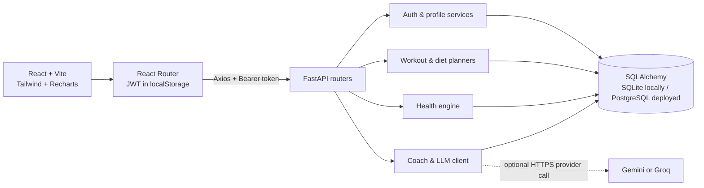

# WellAI

WellAI is a responsive wellness and fitness companion built as a monorepo. The
React app talks to a FastAPI API for accounts, profiles, explainable health
estimates, rule-based workout and meal plans, progress logs, and coach chat.

> WellAI provides general wellness information, not medical diagnosis or
> treatment. Health and calorie values are estimates.

## Features

- JWT registration, login, and protected API endpoints.
- Multi-step profile setup with personalized coaching-track assignment.
- BMI, WHO BMI category, Mifflin-St Jeor BMR, activity-adjusted TDEE, calorie
  targets, and explainable macro estimates.
- Deterministic seven-day workout and four-meal diet plans with equipment,
  injury, and dietary-preference rules.
- Saved plan snapshots, food substitutions, and a daily progress log.
- Weight trend chart, workout completion history, and current streak.
- Persisted coach chat with recent conversation context, optional Gemini/Groq
  integration, and safe local fallback responses.
- Responsive dashboard, accessible form states, global error notifications,
  and browser voice input where supported.

## Architecture



### Repository layout

```text
backend/
  app/
    core/       database, authentication, shared dependencies
    data/       exercise and food JSON catalogs
    models/     SQLAlchemy entities
    routers/    FastAPI endpoints
    schemas/    Pydantic request/response validation
    services/   health, planning, and coach logic
  tests/
  seed_demo.py
frontend/
  public/       favicon and static assets
  src/
    auth/       authentication state
    components/ shared shell, fields, notifications
    pages/      landing, dashboard, plans, progress, coach
```

## Local setup

Requirements: Python 3.10+, Node.js 18+, and npm.

### Backend

From the repository root, use a PowerShell terminal:

```powershell
cd backend
python -m venv venv
.\venv\Scripts\Activate.ps1
pip install -r requirements.txt
Copy-Item .env.example .env
uvicorn app.main:app --reload
```

The API is at <http://127.0.0.1:8000>, health check at
<http://127.0.0.1:8000/health>, and interactive docs at
<http://127.0.0.1:8000/docs>. By default, data is stored in
`backend/wellai.db`. Set `DATABASE_URL` to use another SQLAlchemy database.

Before deploying, set a unique, strong `SECRET_KEY`. The built-in signing key is
for local development only. Generate a value with `python -c "import
secrets; print(secrets.token_urlsafe(48))"` and keep it in the backend
environment. `FRONTEND_ORIGINS` is a comma-separated list of allowed browser
origins; it defaults to `http://localhost:5173`.

### Frontend

Open a second terminal from the repository root:

```powershell
cd frontend
npm install
npm run dev
```

Open the Vite URL, normally <http://localhost:5173>. `VITE_API_URL` optionally
overrides the API URL; its default is `http://localhost:8000`.

### Optional AI Coach provider

The coach works without provider credentials using deterministic local
responses. To enable Gemini, set these in `backend/.env`:

```dotenv
LLM_PROVIDER=gemini
GEMINI_API_KEY=your-gemini-api-key
```

Alternatively, use `LLM_PROVIDER=groq` with `GROQ_API_KEY`. Requests have a
10-second timeout and fall back when a provider fails. Never put provider keys
in frontend variables.

### Demo account

From `backend`, run `python seed_demo.py` to create or refresh the demo account
and 30 days of realistic progress entries:

- Email: `demo@wellai.example.com`
- Password: `WellAI-demo-2026!`

The seed is repeatable and replaces the demo account's progress history. Change
the sample password before exposing a demo deployment publicly.

## Screenshots

Add current screenshots to `docs/screenshots/` and update this table:

| Screen | Screenshot |
|---|---|
| Landing page | _Screenshot placeholder — `docs/screenshots/landing.png`_ |
| Dashboard | _Screenshot placeholder — `docs/screenshots/dashboard.png`_ |
| Workout and diet plans | _Screenshot placeholder — `docs/screenshots/plans.png`_ |
| Progress and coach chat | _Screenshot placeholder — `docs/screenshots/progress-chat.png`_ |

## Dockerfile-free deployment

### Backend on Render

1. Push the repository to a Git provider and create a **Web Service** on Render.
2. Set **Root Directory** to `backend`.
3. Use **Python** as the runtime.
4. Set the build command to `pip install -r requirements.txt`.
5. Set the start command to:

   ```sh
   uvicorn app.main:app --host 0.0.0.0 --port $PORT
   ```

6. Create a managed Render PostgreSQL database. In the web service environment,
   set `DATABASE_URL` to its **Internal Database URL**. WellAI accepts the
   standard `postgresql://` URL and uses the installed psycopg driver.
7. Set `SECRET_KEY` to a cryptographically random value and set
   `FRONTEND_ORIGINS` to the exact production Vercel origin, for example
   `https://wellai.vercel.app` (no trailing slash). Include additional
   comma-separated origins only when they should be trusted.
8. Optionally set `LLM_PROVIDER` and the matching Gemini or Groq API key.
9. Configure Render's health check path as `/health`.

Use PostgreSQL for deployed data. Render's local filesystem is not a durable
database for a standard web-service deployment; SQLite is intended for local
development.

### Frontend on Vercel

1. Import the same repository into Vercel.
2. Set **Root Directory** to `frontend` and framework preset to **Vite**.
3. Use `npm run build` as the build command and `dist` as the output directory.
4. Add the environment variable `VITE_API_URL` with the deployed Render API
   origin, for example `https://wellai-api.onrender.com` (no trailing slash).
5. Deploy, then set the exact Vercel production origin in the Render
   `FRONTEND_ORIGINS` variable and redeploy/restart the API.

`frontend/vercel.json` rewrites client-side routes to the Vite app entry point
so direct navigation and refreshes on `/dashboard`, `/progress`, and other
React Router routes work on Vercel. Vite environment variables are embedded at
build time; redeploy after changing `VITE_API_URL`.

## API overview

| Method | Path | Purpose |
|---|---|---|
| GET | `/health` | Service health check |
| POST | `/auth/register`, `/auth/login` | Create account and receive JWT |
| GET | `/auth/me` | Current authenticated account |
| GET / PUT | `/profile` | Read or save profile |
| GET | `/health-metrics` | Calculate and store explained estimates |
| GET | `/plans/workout`, `/plans/diet` | Generate and save plans |
| POST | `/plans/diet/substitute` | Replace a meal ingredient |
| POST | `/coach/explain`, `/coach/adjust` | Explain or suggest plan adjustments |
| POST | `/chat`, GET `/chat/history` | Persisted coach conversation |
| POST / GET | `/progress` | Create/update a daily log and read history |

## Tests and build

From `backend`, run `python -m pytest -q`. From `frontend`, run
`npm run build`.
